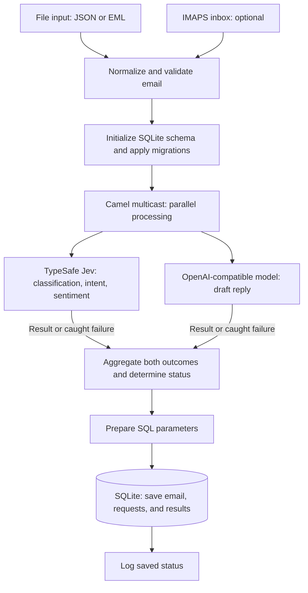

# Email classification and reply drafting

An Apache Camel workflow that analyzes incoming emails with TypeSafe Jev and drafts replies with an OpenAI-compatible model. Both calls run in parallel, and the email, request payloads, results, and processing status are saved to SQLite. Drafts are saved for review; replies are not sent.

## Camel flow



Each AI branch catches provider errors and returns an outcome for aggregation. After a successful database insert, the input consumer archives the file to `.done/` or marks the IMAPS message as seen.

### View the routes with CamelFlow

[CamelFlow](https://github.com/donvito/camel-flow) displays Camel YAML routes as an interactive diagram in your browser and refreshes when files change. With Java 17+ and JBang installed, point it at a route directory:

```bash
jbang camelflow@donvito/camel-flow ./my-routes
```

For this workflow, run from the repository root:

```bash
jbang camelflow@donvito/camel-flow ./ai-email-classification-reply-workflow
```

## Quick start

Requires Java 17+, [Camel JBang](https://camel.apache.org/manual/camel-jbang.html) 4.22.1, and credentials for both AI providers. Python 3 is required for tests; `sqlite3` is optional for inspecting results.

From the repository root:

```bash
cd ai-email-classification-reply-workflow
cp .env.example .env
# Set TYPESAFE_API_KEY and OPENAI_API_KEY in .env.
./run.sh
```

In another terminal, from the same workflow directory:

```bash
mkdir -p data/inbox
cp samples/* data/inbox/
```

After processing completes, inspect the results:

```bash
sqlite3 -header -column data/emails.db \
  'SELECT subject, status, classification, intent, sentiment, draft_reply FROM email_results;'
```

`./run.sh dev` enables reload. Camel may download dependencies on the first run.

## Inputs

By default, the workflow polls `data/inbox` for `.json` and `.eml` files. JSON input contains one email object:

```json
{
  "from": "alex@example.com",
  "subject": "Integration keeps failing",
  "body": "Could you help me reconnect my account?"
}
```

Only `body` is required; all supplied fields must be strings. Blank bodies and bodies longer than 50,000 characters are rejected by default. See [samples/](samples/) for complete examples. MIME emails prefer plain text, convert HTML when needed, and ignore attachments.

To use an IMAPS inbox, add these settings to `.env`:

```dotenv
EMAIL_IMAP_ENABLED=true
EMAIL_IMAP_HOST=imap.example.com
EMAIL_IMAP_USERNAME=support@example.com
EMAIL_IMAP_PASSWORD=your-app-password
EMAIL_FILES_ENABLED=false
```

The mailbox route defaults to port 993 and `INBOX`, polling up to ten unseen messages every 30 seconds. Messages are marked as seen after results are saved, including provider failures, and are not deleted.

## Configuration

`run.sh` loads the gitignored `.env` file. See [application.properties](application.properties) for all settings.

| Variable | Default or purpose |
| --- | --- |
| `TYPESAFE_API_KEY` | Jev credentials |
| `TYPESAFE_MODEL` | `jev-latest` |
| `TYPESAFE_URL` | `https://api.typesafe.ai/v1/systemone` |
| `OPENAI_API_KEY` | Reply provider credentials |
| `OPENAI_MODEL` | `gpt-4.1-mini` |
| `OPENAI_BASE_URL` | `https://api.openai.com/v1` |
| `OPENAI_URL` | Optional full endpoint; overrides the base URL |
| `EMAIL_DB_FILE` | `data/emails.db` |
| `EMAIL_INBOX_DIR` | `data/inbox` |

For another OpenAI-compatible provider, set its API key, model, and base URL. The workflow appends `/chat/completions`; use `OPENAI_URL` for a custom endpoint. Choose a model that supports Chat Completions and `max_completion_tokens`. Restart after changing `.env`.

Customize classification options in [config/jev-questions.json](config/jev-questions.json), keeping the `classification`, `intent`, and `sentiment` question IDs and their `choice` type. Edit [config/reply-prompt.txt](config/reply-prompt.txt) for drafting instructions. The reply model receives the email independently of Jev's analysis.

## Results and failures

The `email_results` table is created automatically. Each row stores email metadata and text, classification, intent, sentiment, a draft reply, and JSON request and result payloads. Authentication headers are excluded; the database contains email content and model outputs.

| Status | Meaning |
| --- | --- |
| `succeeded` | Both providers returned valid results |
| `partial` | One provider succeeded |
| `failed` | Both providers failed |

Provider failures are saved independently so one error preserves the other result. There are no automatic provider retries. Files move to `.done/` after results are saved, including provider failures; invalid input or storage errors move them to `.failed/`. Each processing attempt creates a new row without message deduplication.

## Tests and adaptation

From this directory:

```bash
./run.sh test
```

Integration tests exercise the Camel routes with local mock APIs and temporary SQLite storage. They cover parallel calls, provider failures, input parsing, request capture, persistence, and migrations. No live credentials or mailbox are required.

The [Camel YAML](ai-email-classification-reply-workflow.camel.yaml) defines the flow, [scripts/](scripts/) contains processing logic, and [sql/](sql/) contains database statements. To reuse the example, copy the workflow directory with its source and configuration files, excluding `.env`, `data/`, and generated caches.

[All workflows](../README.md) · [AI Backends](https://aibackends.com/)
